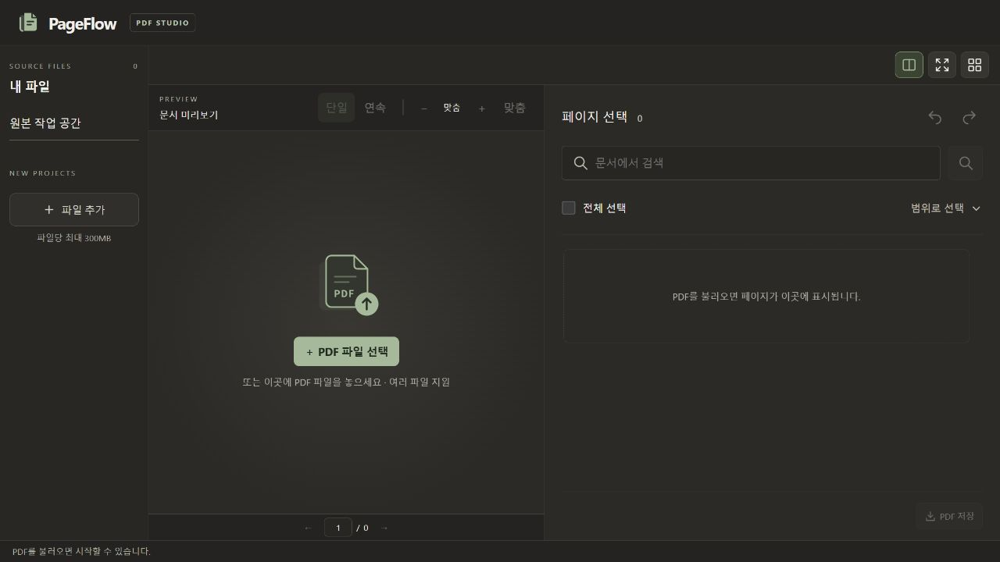
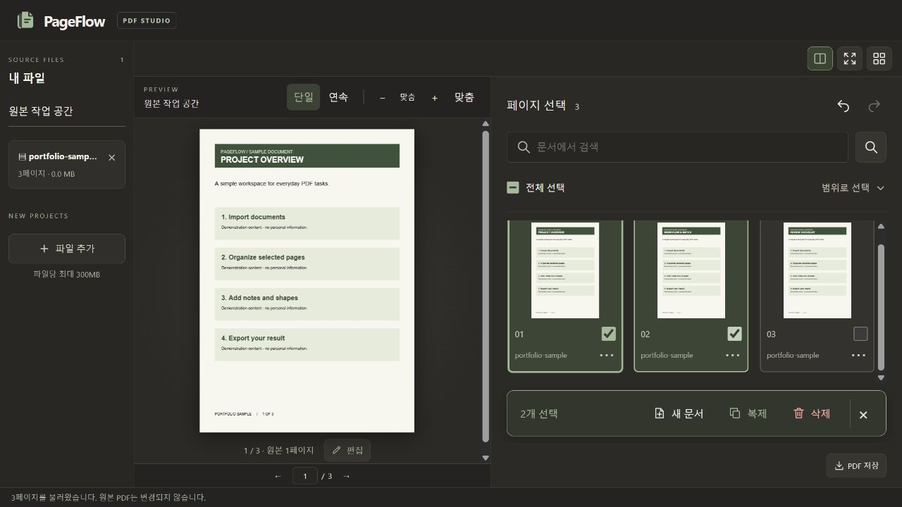
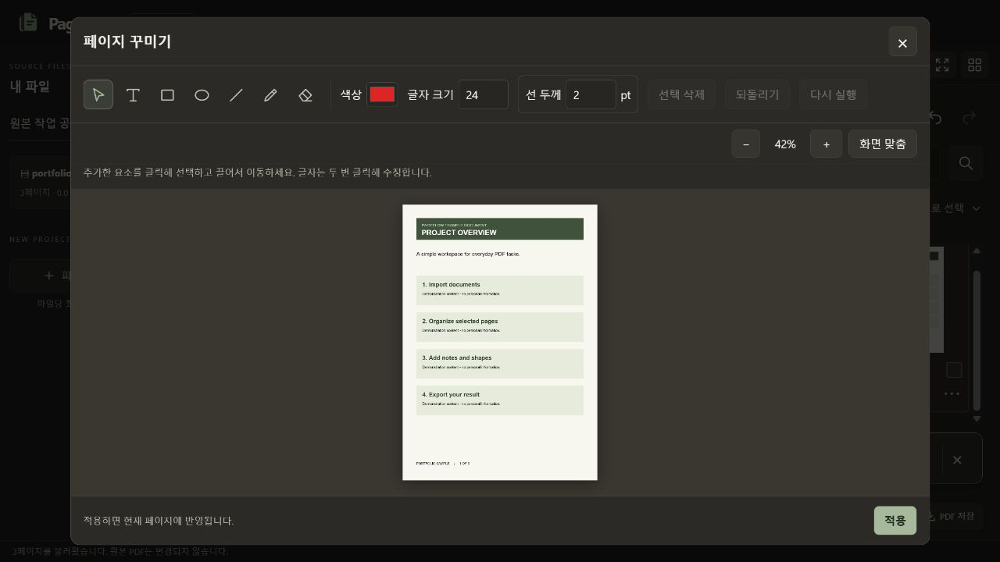
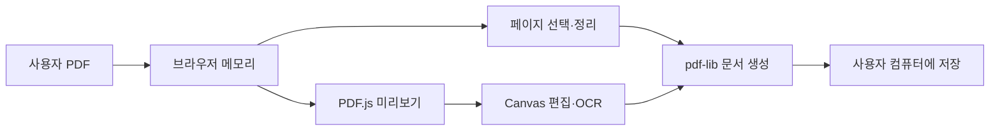

# PageFlow — PDF Studio

브라우저에서 여러 PDF를 불러와 페이지를 정리하고, 글자와 도형을 추가한 뒤 새 PDF로 저장하는 문서 작업 도구입니다.

- 문서화 기준: 2026년 10월 21일
- **라이브 데모: [PageFlow 바로 사용하기](https://pageflow-pdf-studio.vercel.app/)** — 로그인 없이 브라우저에서 체험할 수 있습니다.
- 화면 자료는 개인정보 없는 시험용 문서로 촬영했습니다.

## 목차

1. [프로젝트 소개](#프로젝트-소개)
2. [주요 기능](#주요-기능)
3. [사용자 피드백과 개선](#사용자-피드백과-개선)
4. [기술과 처리 흐름](#기술과-처리-흐름)
5. [실행 및 검증](#실행-및-검증)
6. [현재 한계](#현재-한계)

## 프로젝트 소개

여러 PDF에서 필요한 페이지만 모으고 간단한 표시를 추가하는 작업을 하나의 화면에서 처리하기 위해 만들었습니다. 왼쪽에는 원본 파일, 가운데에는 미리보기, 오른쪽에는 페이지 선택과 작업 도구를 배치했습니다.

PDF 내용은 브라우저 메모리에서 처리합니다. 앱은 가져온 PDF를 서버로 업로드하지 않으며, 사용자가 저장한 결과 파일로 작업을 가져갈 수 있습니다. 새로고침 후의 작업 자동 복구는 아직 지원하지 않습니다.

## 주요 기능

### 여러 PDF와 페이지 정리

파일별 페이지를 확인하고 선택·범위 선택·순서 변경·복제·삭제·회전을 수행합니다. 선택한 페이지로 별도 문서를 만들고 PDF로 저장할 수 있습니다. 가져온 원본 파일 자체는 덮어쓰지 않습니다.



### 페이지 편집

텍스트, 사각형, 타원, 선, 펜을 추가하고 위치와 크기를 조정합니다. 편집 화면 확대·축소, 브러시 크기 커서, 되돌리기·다시 실행을 제공합니다.



### 문서 검색과 OCR

PDF 텍스트 검색과 OCR 기반 검색, 검색 결과 강조 표시를 제공합니다. 스캔 품질과 글꼴, 언어에 따라 OCR 결과가 달라질 수 있습니다.

### 지우개와 배경 보정

앱에서 추가한 내용 지우기와 원본 이미지의 배경 보정을 구분합니다. 컬러 보정은 선택 영역의 주된 색을 주변 종이색으로 대체합니다. 생성형 AI나 의미 기반 복원이 아니며, 가려진 그림과 글자를 재구성하지 않습니다. 원본 배경을 보정한 페이지는 이미지로 저장됩니다.

### PDF 저장

지원 브라우저에서는 저장 위치 선택 창을 사용하고, 지원되지 않으면 브라우저 다운로드로 처리합니다. 취소·실패 시에도 작업 상태를 유지하도록 처리했습니다.

## 사용자 피드백과 개선

| 발견한 문제 | 반영한 개선 |
|---|---|
| 파일 추가 버튼이 중복되고 안내가 많음 | 상단 중복 버튼과 불필요한 안내 제거 |
| 선택 페이지 작업 버튼이 크고 떨어져 있음 | 복제·삭제와 같은 선택 작업 영역에 배치 |
| 편집 메뉴를 찾기 어려움 | 미리보기 아래 편집 버튼 제공 |
| 펜·지우개 크기를 확인하기 어려움 | 크기에 대응하는 커서와 확대·축소 추가 |
| 글자 크기 변경 시 입력 흐름이 끊김 | 투명한 인라인 텍스트 입력과 편집 상태 유지 |
| 지우개가 흰색 덧칠처럼 보임 | 추가 내용 지우기와 원본 배경 보정 분리 |
| 컬러 면 보정 시 색이 번짐 | 대상 색을 배경 샘플에서 제외하고 종이색으로 보정 |

기획·화면 판단·실제 문서 사용 피드백을 바탕으로 반복 개선했으며, 구현과 테스트 정리에 AI 코딩 도구를 활용했습니다.

## 기술과 처리 흐름

- UI: HTML, CSS, JavaScript ES Modules, Canvas API
- PDF 미리보기: PDF.js
- PDF 생성·페이지 조합: pdf-lib
- OCR: Tesseract.js와 로컬 배포 언어 데이터
- 검증: Node.js 스크립트와 브라우저 수동 확인
- 배포 파일: 정적 HTML과 내용 기반 해시를 붙인 JS/CSS



```text
pageflow-pdf-studio/
├─ dist/                  # 실행 가능한 정적 사이트
│  ├─ app.js              # 화면과 편집 흐름
│  ├─ core.mjs            # 페이지 처리·검색 좌표·배경 보정
│  ├─ songbook.mjs        # 곡 단위 문서 선택 보조 로직
│  └─ vendor/             # PDF·OCR 라이브러리와 고지 파일
├─ scripts/               # 정적 자산 생성·로컬 서버
├─ docs/assets/readme/    # 예제 화면
└─ test*.mjs              # 기능 검증 스크립트
```

## 실행 및 검증

Node.js 20 이상을 기준으로 실행합니다.

```bash
npm ci
npm test
npm run build
npm start
```

브라우저에서 `http://127.0.0.1:4173`을 엽니다. [예제 PDF](docs/samples/portfolio-sample.pdf)로 기능을 확인할 수 있습니다. 빌드 결과는 `dist/`이며 정적 웹 호스팅에 배포할 수 있습니다. 소스 수정은 해시 없는 `app.js`, `core.mjs`, `style.css`에 하고 `npm run build`로 배포 파일을 갱신합니다.

| 검사 | 범위 |
|---|---|
| test.mjs | 범위 입력, 순서 변경, 병합·추출·회전, 원본 데이터 유지 |
| test-save.mjs | 저장 성공·취소·권한 거절·다운로드 대체·쓰기 실패 |
| test-highlights.mjs | 한글·반복·부분 검색과 강조 좌표 |
| test-songs.mjs | 곡 선택과 페이지 참조·순서 |
| test-restore.mjs | 종이색 보정, 인쇄선 보호, 색 번짐 방지, 이미지 대체 출력 |

위 검사는 자동화된 로직 검사입니다. 모든 브라우저·대용량 문서·OCR 인식 정확도를 보장하는 성능 인증은 아닙니다.

## Vercel 배포

[Deploy with Vercel](https://vercel.com/new/clone?repository-url=https%3A%2F%2Fgithub.com%2Fdltkdgur1123%2Fpageflow-pdf-studio)

기존 저장소 연결은 Vercel의 **Add New → Project**에서 이 저장소를 선택합니다. 루트 디렉터리는 저장소 최상위이며, 환경변수는 필요하지 않습니다. `vercel.json`에 설치 명령, 검사·빌드 명령, 출력 폴더 `dist`가 지정되어 있습니다. Git 연결 후 `main`에 반영한 변경은 Vercel이 자동 배포합니다.

## 현재 한계

- 자동 저장과 새로고침 후 작업 복구는 미지원입니다.
- 파일당 300MB 제한이 있지만, 실제 처리 가능한 양은 기기 메모리와 문서 구조에 따라 달라집니다.
- 원본 배경 보정은 실험적인 기능입니다. 사진·그라데이션·복잡한 무늬에는 적합하지 않을 수 있습니다.
- 배경 보정된 페이지는 이미지로 출력되어 원래의 벡터·텍스트 선택 특성이 유지되지 않습니다.
- 원본의 기존 텍스트를 워드프로세서처럼 직접 재편집하는 도구는 아닙니다.
- 다음 개선 과제는 자동 복구, 대용량 문서 안정성, 브라우저별 검증입니다.

## 공개 자료와 라이선스

실제 사용자 PDF, 예약 정보, 비공개 배포 설정 및 인증 정보는 이 저장소 구성에서 제외했습니다. `dist/vendor/`의 타사 라이브러리에는 각 라이선스와 고지가 적용됩니다. 자체 코드의 오픈소스 라이선스는 아직 지정하지 않았습니다.
